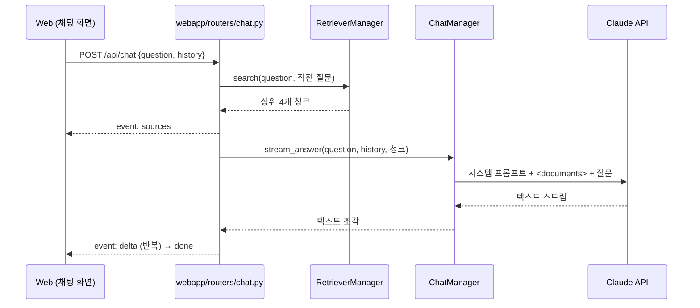

# 아키텍처

## RAG 동작 흐름

## 계층 구조

| 계층 | 위치 | 역할 |
|---|---|---|
| Router | `webapp/routers/` | 요청 검증(DTO), Manager 호출, SSE 응답 |
| Dependency | `webapp/dependency.py` | Manager 인스턴스 생성·주입 |
| Manager | `src/*/manager.py` | 검색, 답변 생성 비즈니스 로직 |
| Domain | `src/domain.py` | `Chunk`, `SearchResult` 데이터 클래스 |

## 설계 결정

- **임베딩 대신 BM25**: 개인 자기소개처럼 문서 양이 적으면 키워드 검색으로 충분하고, 벡터 DB 없이 배포할 수 있습니다. 한국어 조사 문제는 글자 바이그램으로 보완했습니다.
- **근거 기반 답변**: 문서에 없는 내용은 추측하지 않도록 지시하고, 답변마다 참고한 섹션을 화면에 표시합니다.
- **후속 질문 처리**: 직전 사용자 질문을 검색어에 합쳐 "그 프로젝트에서 어려웠던 점은?" 같은 질문도 찾습니다.
- **비용 보호**: IP당 10분에 20회 요청 제한, 질문 길이 500자 제한.
