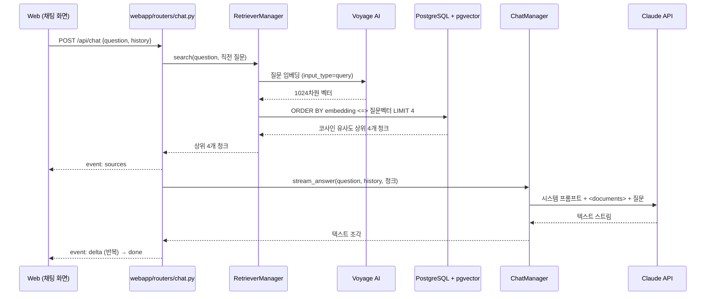

# 아키텍처

## RAG 동작 흐름

## 계층 구조

| 계층 | 위치 | 역할 |
|---|---|---|
| Router | `webapp/routers/` | 요청 검증(DTO), Manager 호출, SSE 응답 |
| Dependency | `webapp/dependency.py` | Manager 인스턴스 생성·주입 |
| Manager | `src/*/manager.py` | 적재·검색, 답변 생성 비즈니스 로직 |
| Repository | `src/chunk/repository.py` | pgvector 테이블 저장·유사도 검색 |
| Domain | `src/domain.py` | `Chunk`, `SearchResult` 데이터 클래스 |

## 설계 결정

- **pgvector 벡터 검색**: 문서 섹션과 질문을 Voyage AI로 임베딩하고, PostgreSQL의 pgvector로 코사인 유사도 검색을 합니다. 키워드가 달라도(예: "어디서 일해요?" ↔ "경력") 의미가 비슷하면 찾을 수 있습니다. 데이터가 적어도 HNSW 인덱스를 만들어 두어 문서가 늘어나도 그대로 쓸 수 있습니다.
- **문서/질문 임베딩 구분**: Voyage의 `input_type`을 문서는 `document`, 질문은 `query`로 나눠 검색 품질을 높였습니다.
- **적재와 서빙 분리**: 임베딩 저장은 `scripts/ingest.py`로 따로 실행해서, 서버를 띄울 때마다 임베딩 API를 호출하지 않습니다.
- **근거 기반 답변**: 문서에 없는 내용은 추측하지 않도록 지시하고, 답변마다 참고한 섹션을 화면에 표시합니다.
- **후속 질문 처리**: 직전 사용자 질문을 검색어에 합쳐 "그 프로젝트에서 어려웠던 점은?" 같은 질문도 찾습니다.
- **비용 보호**: IP당 10분에 20회 요청 제한, 질문 길이 500자 제한.
